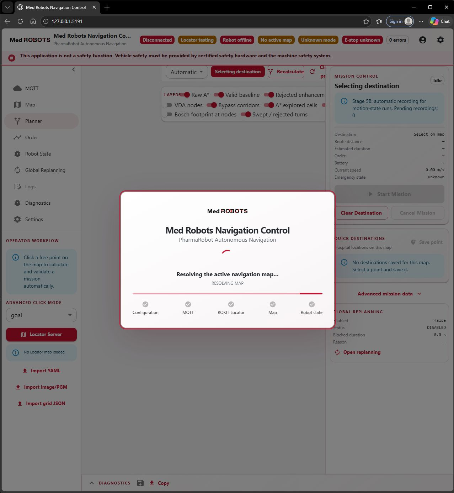
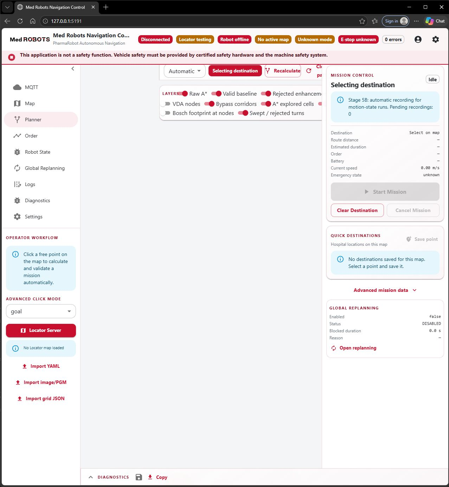

# Mission Planner UI audit

**Audit date** 25 November 2026  
**Baseline** `caa7f7af894edd9dacd26600877c68dd4f0cbb9a`  
**Worktree** `C:\Users\Avarynx\WebstormProjects\Bosch\mission-planner-ui` on `feature/ui-improvements`

I read [AGENTS.md](AGENTS.md) and verified the branch, worktree and clean starting state with Git. Git listed a separate `mission-planner-map` worktree on `feature/map-cleaner` and a separate `master` worktree. The audit touched only this worktree. It used the frontend on loopback with the robot bridge stopped. No robot commands, application changes, commits or merges were made.

## Summary

- **The map workspace can lose its controls at desktop widths.** In Edge, the right mission drawer covered the map toolbar and layer controls. The main pane reserves space for the permanent navigation drawer twice. See [F1](#findings-and-priorities).
- **The UI can describe a different state from the one the operator can act on.** Verified examples include an offline robot paired with “Idle” and “0.00 m/s”, a Locator badge stuck on “testing”, and a dead MQTT navigation item. Source review also found stale route-phase and countdown labels, settings that persist without changing behavior, and an alternate entry point that arms replanning without the dedicated dialog’s confirmation.
- **Offline verification passed with one worker.** All 420 tests passed across 50 files sequentially. The default parallel run failed three planner assertions. Two were explicit duration thresholds. The third was a route-success assertion near a three-second run time. All three passed on a targeted sequential rerun.

## Architecture and boundaries

The application has one React workspace and no client-side router. `App` composes startup, the fixed status and safety header, left navigation, the map and toolbar, the right mission drawer, bottom diagnostics, dialogs and snackbars. Navigation changes local state. Several navigation entries have no handler branch. The mission drawer is permanent above 1100 CSS px and opens as a temporary drawer from the header at or below that breakpoint. MUI provides components and theme. CSS and inline styles control layout and animation. The same entry point runs in Vite, the Express static web deployment and Electron. [Renderer](src/main.tsx#L1), [theme](src/app/theme.ts#L1), [shell](src/App.tsx#L900), [styles](src/app/styles.css#L17), [web host](server/index.ts#L26), [Electron window](electron/main.ts#L7).

| Area | Data and control flow |
| --- | --- |
| UI state | React local state holds dialogs, selected mode, tabs and filters, route-phase text, countdown and toast. `MapCanvas` holds pan, zoom, hover and layer visibility. Writes to planner inputs through `appStore.set` invalidate the route revision and cached order. Telemetry updates the start via a distinct store method. [App](src/App.tsx#L147), [map](src/components/MapCanvas.tsx#L18), [route state](src/stores/appStore.ts#L103). |
| Persistence | The main Zustand store persists MQTT settings with password blanked, order and planner settings, footprint, planner mode, goal, grid/inflation visibility, view rotation, map metadata and map binding. Locator persists settings and selection with CA content and insecure mode stripped. Separate stores persist operator preferences, destinations, replanning and recovery settings. Recovery password and bearer token are stripped. Telemetry, active orders and map occupancy are runtime state. [Main store](src/stores/appStore.ts#L293), [Locator](src/features/locator/stores/locatorStore.ts#L50), [operator](src/features/settings/operatorSettingsStore.ts#L27), [destinations](src/features/destinations/destinationStore.ts#L24), [replanning](src/features/replanning/globalReplanningStore.ts#L51), [recovery](src/features/recovery/recoveryStore.ts#L40). |
| Maps and planning | Local PNG/JPEG/PGM, YAML metadata, JSON grids and Locator raster downloads converge at `loadGrid`. The workspace shares `grid` and `inflatedGrid` across display, destination validation and planning consumers. Manual routes use direct collision checks. Automatic, Hybrid and Motion state use `PlanningCoordinator` → `PlannerService` / worker → revision-checked commit. The diagnostic clearance viewer uses a separate runner and writes no operational route. [Load and plan](src/App.tsx#L298), [coordinator](src/features/planning/PlanningCoordinator.ts#L53), [planner service](src/domain/planner/PlannerService.ts#L1), [worker](src/workers/planner.worker.ts#L1), [clearance runner](src/features/locator/services/diagnosticPlannerRunner.ts#L1). |
| MQTT / Navigator | `MqttService` connects directly over MQTT WebSocket or through the local `/bridge` WebSocket to the Express TCP adapter. It subscribes to VDA state, visualization and connection. `useMqtt` parses schemas, filters robot identity, tracks receive time, resolves map and pose, and stores errors/raw payloads. Orders and instant actions use configured MQTT topics. `VdaOrderBuilder`, `VdaOrderValidator`, the generation and dispatch gates, and `MissionMonitor` handle their lifecycle. [MQTT service](src/services/MqttService.ts#L21), [bridge](server/index.ts#L36), [receive hook](src/hooks/useMqtt.ts#L16), [order generation](src/App.tsx#L385), [dispatch](src/App.tsx#L541), [monitor](src/domain/order/MissionMonitor.ts#L1). |
| Locator | Browser services call local POST endpoints for configure, test, manual/automatic login, forget credentials and logout, and `/locator/map/:method` for ServerMap RPC. The map service parses responses and converts the raster to occupancy. The layer comparison reads compatible map metadata and point-cloud data separately. [Proxy routes](server/locatorProxy.ts#L180), [map API](src/features/locator/api/serverMapApi.ts#L9), [map service](src/features/locator/services/locatorMapService.ts#L40), [comparison service](src/features/locator/services/mapDiagnostics.ts#L1). |
| Replanning and recovery | `useGlobalReplanning` watches telemetry, route and runtime stores. It can replace an active order through MQTT. Recovery uses its own runtime and configured driving-mode source. ctrlX mode reads through local POST `/ctrlx/configure` and `/ctrlx/read`, which proxy read requests. The panel exposes settings and evidence. [Hook](src/features/replanning/useGlobalReplanning.ts#L81), [recovery](src/features/recovery/RecoveryOrchestrator.ts#L1), [provider](src/features/recovery/DrivingModeTelemetryProvider.ts#L46), [proxy](server/ctrlxDataLayerProxy.ts#L166). |
| Evidence and desktop wrapper | `LogService` feeds the in-memory operational log. Diagnostics copy/export sanitize payloads, while raw panel views display stored data. Motion-state scenario export is a browser download. Stage 5B records evidence in memory until its POST to `/api/stage5b/missions` succeeds. Express also exposes `GET /health`. Electron launches the bridge in packaged mode and exposes config and secret IPC through preload. The renderer's settings dialogs currently use browser import/export. [Logs](src/services/LogService.ts#L1), [diagnostics](src/App.tsx#L1300), [recorder](src/services/Stage5BRecordingService.ts#L14), [recorder endpoint](server/stage5BRecording.ts#L9), [health](server/index.ts#L23), [Electron IPC](electron/preload.ts#L1). |

## Feature inventory and functionality matrix

**Working** means the described behavior was implemented and verified at the stated scope. **Partially working** means it is wired but has a limitation or its end-to-end UI behavior was not exercised. **Broken** means a concrete mismatch is demonstrated by browser observation or source. **Not implemented** includes intentionally disabled and disconnected controls. **Obsolete** identifies an unused or redundant entry. **Unverified** requires a running service, real telemetry or equipment. Evidence markers are **B** for Edge, **T** for automated tests, and **S** for source inspection. A fixture test verifies the fixture behavior only. Source-based classifications name the code path so they can be reproduced.

### Startup, navigation and map workspace

| Feature / controls | Assessment | Evidence and implementation |
| --- | --- | --- |
| Startup branding, progress, configuration/MQTT/Locator/map/robot step icons, retry, continue in advanced mode | **Partially working** | **B/T/S**. Blocking startup progressed through map resolution and robot wait. The workspace was later accessible offline. Retry and optional-failure behavior are covered at manager level. Per-step icons use phase heuristics and can move backwards or suggest a service completed when it failed. The capture did not verify how the terminal overlay was dismissed. [Overlay](src/features/startup/StartupOverlay.tsx#L10), [manager](src/features/startup/StartupConnectionManager.ts#L13), [tests](src/tests/operatorWorkflow.test.ts#L73). |
| Automatic MQTT, Locator connection/login, list/load, map resolution and localization readiness | **Unverified** | **S**. The hook attempts these in order. MQTT starts asynchronously, Locator depends on bridge/ServerMap and credentials, and map/robot waits have separate timeouts. Only the offline path was observed. [Startup hook](src/features/startup/useStartupConnections.ts#L25). |
| Static brand, certified-safety banner, MQTT disconnected, robot offline, map, mode, e-stop and error badges | **Working** for static/offline render, **Unverified** for live values | **B/S**. Edge rendered the expected offline and unknown badges. Live state and map badges depend on the parsed topics. The robot connection badge has no freshness check. The Locator status can remain “testing” after failed startup (F6). [Derivation](src/App.tsx#L211), [header](src/App.tsx#L904). |
| Account/operator session icon | **Not implemented** | **S**. Focusable icon has a tooltip but no onClick, menu or account workflow. [Header](src/App.tsx#L925). |
| Nav collapse/expand, Map, Settings, Global Replanning, Diagnostics | **Partially working** | **B/S**. Controls rendered. Collapse toggles drawer width and hides the workflow/import section. Map and Settings open dialogs, Global Replanning opens its panel, Diagnostics opens the bottom dock. Tablet mission opener is wired but was not exercised. [Shell](src/App.tsx#L925), [nav](src/App.tsx#L932), [mission drawer](src/App.tsx#L991). |
| MQTT, Order, Robot State, Logs sidebar entries | **Not implemented** | **B/S**. MQTT click produced no workspace change. The four items have no matching handler branch despite relevant controls elsewhere. [Nav handler](src/App.tsx#L940). |
| Planner sidebar entry | **Obsolete** as an action | **S**. Always selected as the current workspace marker and has no action. [Nav handler](src/App.tsx#L940). |
| Operator workflow prompt and duplicate Locator launcher | **Partially working** | **B/S**. Prompt and launcher render. Launcher opens the same dialog as Map. The prompt offers a map click while no grid exists, which has no effect. The “No Locator map loaded” hint remains specific to Locator and can coexist with a local map. [Workflow controls](src/App.tsx#L950), [canvas click](src/components/MapCanvas.tsx#L228). |
| Import YAML | **Partially working** | **S**. Stages YAML text in React state for the next image import. No selected filename, success status, error handler for file reading or clear/reset control. It does not load a map by itself. [File inputs](src/App.tsx#L959), [image handler](src/App.tsx#L736). |
| Import image/PGM and grid JSON | **Partially working** | **B/T/S**. Image picker opened. File selection and rendered import were not observed. Pixel occupancy/polarity tested. PGM and browser image decoding, YAML metadata, the JSON parser and grid commit are wired. Errors go to the operational log. [Inputs](src/App.tsx#L960), [importer](src/domain/map/MapImporter.ts#L1), [conversion tests](src/tests/mapImporter.test.ts#L11). |
| Map metadata and loading overlay | **Partially working** | **B/S**. Offline metadata is “No map loaded”. Loaded state shows dimensions and resolution, with a separate Locator download overlay. At the captured width the metadata was covered by the mission drawer. [Toolbar and overlay](src/App.tsx#L968). |
| Planner mode selector and Recalculate | **Partially working** | **B/T/S**. Automatic, Manual, Hybrid, Motion state (experimental) select the store mode. Recalculate has a browser-visible button and source-wired calculation, but with missing prerequisites only logs an error. It calculates the path without running the full generate/validate workflow. Manual uses explicit waypoints, Hybrid splits across them, Motion state selects its planner strategy. [Toolbar](src/App.tsx#L970), [calculate](src/App.tsx#L319), [coordinator](src/features/planning/PlanningCoordinator.ts#L53), [planner tests](src/tests/planner.test.ts#L1). |
| Clear path | **Partially working** | **B/T/S**. Invalidates coordinator and store route outputs. Does not reset the separate phase/countdown UI. The captured toolbar obscured part of the button. [Toolbar](src/App.tsx#L974), [store](src/stores/appStore.ts#L124), [revision tests](src/tests/routeSelectionRevision.test.ts#L1). |
| Click mode Goal | **Partially working** | **T/S**. Validates cell, current map and fresh pose, plans, builds and validates an order. With a local map only, a manually selected start cannot substitute for the telemetry pose in this workflow. An empty workspace silently ignores canvas clicks. [Goal flow](src/App.tsx#L620), [goal test](src/tests/operatorWorkflow.test.ts#L19), [canvas](src/components/MapCanvas.tsx#L228). |
| Click modes Start and Waypoint | **Partially working** | **S**. Convert cells to world poses, set planning start or append a waypoint. Manual/Hybrid expose the editor. The main map draws a start footprint but does not draw standalone waypoints before recalculation. Manual start and live robot pose have different semantics and can be confused (F7). [Cell handlers](src/App.tsx#L306), [canvas overlays](src/components/MapCanvas.tsx#L182). |
| Click modes Obstacle and Erase | **Partially working** | **S**. One cell per click changes the shared grid to 100 or 0 and recalculates displayed inflation. No separate editable map, edit history or wall completion. On an active Locator raster the opaque image can conceal occupancy changes (F3). [Cell handlers](src/App.tsx#L306), [raster draw](src/components/MapCanvas.tsx#L68). |
| Click mode Inspect, hover and context menu | **Partially working** | **S**. Hover shows grid/world coordinates. Inspect click writes `selectedCell` without a dedicated visible selection/details panel. Right-click updates the grid cell without refreshing world coordinates. Moving out of the valid area retains prior values. [Canvas events](src/components/MapCanvas.tsx#L228), [click dispatch](src/App.tsx#L317). |
| Grid, Inflated obstacles, Rotate view | **Partially working** | **B/S**. Toggles are wired to the canvas, with grid lines only above 8 px/cell and view rotation in 90° increments. Controls were obscured at the observed desktop width. These are display controls. [Toolbar](src/App.tsx#L980), [drawing](src/components/MapCanvas.tsx#L68). |
| Pan, wheel zoom, minus/plus, percent and Fit | **Partially working** | **B/S**. Mouse drag pans, wheel clamps zoom to 0.35–8, button zoom is unclamped and Fit resets pan/zoom. Bottom controls existed in the accessibility tree but fell below the visible workspace in the capture. Main canvas uses mouse handlers and has no keyboard placement or touch pan/pinch path. [Canvas events and controls](src/components/MapCanvas.tsx#L228). |
| Layer switches | **Partially working** | **B/S**. Raw A*, Valid baseline, Rejected enhancement, Optimized path, VDA nodes, Bypass corridors, A* explored cells, Doors and alignment, Bosch footprint at nodes and Swept/rejected turns update local visibility. “VDA nodes” labels final-path points, which may differ from generated order nodes. Layer switches remain visible without a map and were partially covered. [Rendering](src/components/MapCanvas.tsx#L126), [switches](src/components/MapCanvas.tsx#L264). |
| Operational map overlays | **Partially working** locally, **Unverified** with live data | **T/S**. Canvas combines occupancy, Locator image, inflation, route/segments, diagnostics, start/goal, robot marker/heading/footprint and position status. Replanning adds original/blocked/replacement paths, temporary cells and inflation, explored cells, projected start and recovery path. Pose display logic has fixture coverage. [Drawing](src/components/MapCanvas.tsx#L68), [pose model](src/components/mapRobotVisualization.ts#L1), [tests](src/tests/mapRobotVisualization.test.ts#L1). |

### Mission control, advanced mission data and diagnostics

| Feature / controls | Assessment | Evidence and implementation |
| --- | --- | --- |
| Mission card status, destination, distance, estimate, order ID, battery, speed, emergency state | **Partially working** | **B/S**. Displays the goal, summed path length and distance ÷ maximum speed estimate, plus received state. Offline showed Idle and 0.00 m/s with no telemetry. Display also repeats the route phase and e-stop. Real telemetry was not used. [Summary values](src/App.tsx#L744), [card](src/App.tsx#L996). |
| Corridor counts, min/max widths, missing/partial coverage | **Partially working** | **T/S**. Computed from generated edges. Warning infers that Navigator obstacle avoidance is enabled from a local corridor-generation setting. Corridor build/validation is covered with fixtures. [Summary and warning](src/App.tsx#L750), [card](src/App.tsx#L1015), [tests](src/tests/corridor.test.ts#L1). |
| Start Mission and Send Mission/Back confirmation | **Unverified** end to end | **B/T/S**. Disabled offline in Edge. Order builder, validator and gate have tests plus mocked publish coverage. UI checks order revision, duplicates, MQTT, robot online/fresh pose, map, order validation and active mission. Actual publish, acceptance and driving were outside scope. [Button](src/App.tsx#L1035), [handler](src/App.tsx#L541), [gate tests](src/tests/operatorWorkflow.test.ts#L26), [mock integration](src/tests/integration.test.ts#L1). |
| Direct Dispatch Mode, countdown and Cancel | **Partially working**, dispatch **Unverified** | **S**. Preference enables countdown after order validation, with explicit cancel and telemetry checks. Route changes can return early with the old countdown still displayed (F4). [Countdown](src/App.tsx#L605), [card](src/App.tsx#L1030), [settings](src/App.tsx#L1754). |
| Clear Destination and confirmation | **Partially working** | **B/S**. Visible offline. Handler clears preview and destination, confirms when an order is present and leaves the sent mission alone. Global Escape can clear the preview while dismissing a different dialog (F2). [Clear and Escape](src/App.tsx#L679), [button](src/App.tsx#L1044). |
| Cancel Mission | **Unverified** | **B/S**. Disabled with no active/sent order. Connected path has confirmation and emits `cancelOrder` on the instant-action topic. Offline and publish failures lack immediate action feedback (F6). [Button](src/App.tsx#L1046), [handler](src/App.tsx#L720). |
| Quick Destinations, Save point, name/category dialog, saved point buttons | **Partially working** | **B/T/S**. Empty card and disabled Save point verified offline. Save uses local persistence keyed by Navigator map ID. Selection reuses destination preparation and requests the saved heading. Categories are pharmacy, laboratory, reception, ward, charging, delivery, home and other. Button/submit disable conditions omit the required map ID. Store supports update/remove, but there is no management UI. [Card](src/features/destinations/QuickDestinations.tsx#L14), [store](src/features/destinations/destinationStore.ts#L24), [handlers](src/App.tsx#L844), [dialog](src/App.tsx#L1416). |
| Advanced mission data toggle and Robot State, pose and first-node panels | **Partially working** locally, **Unverified** with live robot | **T/S**. Shows operating mode, driving/paused, active order/node, battery, initialization, age, planning start/goal, map/pose source and first-node deviations/limits. State freshness and map binding checks have fixtures. “Robot x/y” and θ read the planning start, which can be manually set. [Panel](src/App.tsx#L1053), [first node](src/App.tsx#L1225), [telemetry tests](src/tests/telemetryFlow.test.ts#L1). |
| Goal theta | **Partially working** | **S**. Normalizes numeric radians, marks orientation explicit and invalidates dependent route outputs. The field is enabled with no goal even though changes are ignored. [Field](src/App.tsx#L1069), [store](src/stores/appStore.ts#L103). |
| Planner statistics and status/stage details | **Partially working** | **T/S**. Displays point counts, visited cells, duration, door/passages and turn metrics, clearance, selected source, stage evidence, free-space connectivity, physical rejection reasons and replanning stats. No-plan state displays `RAW_PATH_FAILED`. Internal codes and lengthy stages crowd the controls. [Panel](src/App.tsx#L1072), [stage list](src/App.tsx#L1113), [baseline tests](src/tests/reliableBaseline.test.ts#L1). |
| Use valid baseline route | **Partially working** | **T/S**. Commits baseline geometry and rebuilds motion-plan evidence for that geometry. Does not itself generate an order or synchronize the phase text. [Action](src/App.tsx#L490), [button](src/App.tsx#L1123). |
| Maximum speed, Speed Limit Analysis, diagonal movement, wall/turn cost, plan/segment limits, effective Motion-state disclosure | **Partially working** | **T/S**. Edits planner/order settings, normalizes speed and reports configured/edge/allowed/command/observed speed. The motion-state disclosure shows effective costs, clearance, sampling, heading lattice and permissions. Motion-state hides several legacy controls. Planner settings are duplicated in Settings. [Controls](src/App.tsx#L1140), [effective configuration](src/App.tsx#L118), [speed tests](src/tests/speedLimitDiagnostics.test.ts#L1). |
| Generate & validate VDA order, Rebuild Order From Current Pose, validation and map binding alerts | **Partially working** locally, **Unverified** with live robot | **T/S**. Manual generation uses current-revision path. Rebuild checks prerequisites, plans from the current pose, then generates. Failures can be visible only in validation/diagnostics or present as a count. Binding warnings render in the advanced section. [Generation](src/App.tsx#L385), [rebuild](src/App.tsx#L528), [buttons](src/App.tsx#L1192), [alerts](src/App.tsx#L1245), [order tests](src/tests/orderSafety.test.ts#L1). |
| Export order, path and last motion-state run | **Partially working** | **T/S**. Client JSON exports are gated on available data. Scenario export validates captured artifact and includes the map, including for failed runs. Capture/schema is tested. Browser download was not exercised. [Exports](src/App.tsx#L1200), [scenario tests](src/tests/motionScenarioExport.test.ts#L1). |
| Stage 5B status, finalize success/failed/cancelled, retry save | **Partially working**, real bridge save **Unverified** | **B/T/S**. Status card rendered offline. Service tests cover mocked save/retry and outcome handling. Operator actions remain enabled with zero pending items and provide no action-specific feedback when nothing can change. [Card](src/App.tsx#L1003), [actions](src/App.tsx#L1213), [service](src/services/Stage5BRecordingService.ts#L39), [tests](src/tests/stage5BRecordingService.test.ts#L1). |
| Pause, Resume, State request | **Not implemented** as usable controls | **S**. Permanently disabled. The UI cites a rejected pause blocking type and an unconfirmed state-request action. No button handler is attached. [Disabled actions](src/App.tsx#L1261). |
| Manual/Hybrid waypoint editor | **Partially working** | **S**. Displays ordered waypoints with x, y, θ, deviation, orientation lock, delete and up/down controls. Editing invalidates the route. Point creation lives in another drawer and reorder/delete lack clear accessible names. [Editor](src/App.tsx#L1270), [map placement](src/App.tsx#L310). |
| Sent mission progress/status and Global Replanning summary | **Unverified** for live progression, summary **Partially working** | **B/S**. Replanning summary rendered disabled with status, blocked time and reason. Sent mission panel derives acceptance, progress, distance to next node and rejection details from `MissionMonitor` and incoming state. [Panels](src/App.tsx#L1286), [monitor](src/domain/order/MissionMonitor.ts#L1). |
| Diagnostics dock, Operational Log, search and severity | **Partially working** | **B/S**. Dock and copy rendered in its closed state. Expanded Operational Log filters by message and severity. Filters are displayed on all tabs even though the other views ignore them. [Dock and filters](src/App.tsx#L1300). |
| Pause auto-scroll | **Not implemented** | **S**. Switch only updates `pauseLogScroll`. There is no auto-scroll effect or consumer for the value. [State](src/App.tsx#L163), [switch](src/App.tsx#L1381). |
| Validation, ROKIT Errors, MQTT State, MQTT Visualization, Generated Order, Locator, Network, Raw JSON | **Partially working** locally, live data **Unverified** | **T/S**. Tabs serialize their related stores, including current and historical ROKIT errors, raw telemetry, corridor metadata, session and network status, or sanitized aggregate diagnostic JSON. Missing inputs often show `{}`, null fields or placeholders. Parsing, history and validation behavior have fixture coverage. [Tab rendering](src/App.tsx#L1385), [telemetry tests](src/tests/telemetryFlow.test.ts#L1). |
| Clear view, Clear error history, save diagnostic bundle, Copy tab | **Partially working** | **T/S**. Clear view empties the operational log across tabs. History clear is independent and leaves current errors. Bundle and tab copy sanitize recursively. Clipboard promises have no success or failure feedback. [Actions](src/App.tsx#L1313), [clear controls](src/App.tsx#L1381), [sanitizer test](src/tests/operatorWorkflow.test.ts#L62). |
| Common confirmations and notifications | **Partially working** | **B/S**. Reusable promise-based confirmation offers Back, dismiss and confirm. Snackbar auto-hides at 4.5 seconds. Some flows log failures without notifying. Global Escape can affect the underlying destination across dialog contexts. [Confirmation resolver](src/App.tsx#L198), [Escape](src/App.tsx#L691), [dialog/snackbar](src/App.tsx#L1464). |

### Settings dialog

Individual field changes are live store writes. Closing the dialog does not roll them back. The matrix describes visible groups and the effect of each field within them.

| Feature / controls | Assessment | Evidence and implementation |
| --- | --- | --- |
| MQTT auto-connect, broker host/port, TCP bridge/WebSocket, username/password, TLS, Connect, Disconnect & reset | **Partially working** for settings, **Unverified** live | **S**. Persisted except password. Connect uses the current fields and disconnect clears session state. WebSocket path, QoS and keepalive exist in settings but have no dedicated input. Status/errors are surfaced via header, startup and logs. [Connection fields](src/App.tsx#L1509), [actions](src/App.tsx#L1824), [MQTT](src/services/MqttService.ts#L21), [defaults](src/domain/defaults.ts#L10). |
| Locator auto-connect, auto-login, host, RPC port/endpoint, HTTPS, Forget saved Locator credentials | **Unverified** live | **S**. Writes Locator prefs, and Forget calls the proxy then updates the session label. Failures log without local action feedback. Connection coordinates are duplicated in the Locator dialog. [Settings](src/App.tsx#L1521), [session service](src/features/locator/services/locatorSessionService.ts#L1). |
| Navigation tuning | **Partially working** | **T/S**. Wall cost, turn cost, max planning time, segment length, max VDA node count and diagonal toggle are wired to planner or order generation, with some fields hidden in Motion state. No shared inline validation for most numeric inputs. [Settings](src/App.tsx#L1543), [node count enforcement](src/App.tsx#L429). |
| Destination validation radius | **Not implemented** | **S**. Preference is persisted. `validateDestination` reads the target and occupancy/inflation grids without reading this radius. [Field](src/App.tsx#L1569), [validator](src/features/mission/destinationValidation.ts#L10). |
| Navigation policy and reliable baseline switch | **Partially working** | **T/S**. Reliable / Balanced / Advanced and the switch update the same policy. Switch off explicitly selects Balanced. Policy behavior is tested independently. [Controls](src/App.tsx#L1577), [tests](src/tests/reliableBaseline.test.ts#L1). |
| Passage Alignment and Turn Safety | **Partially working** | **T/S**. Densification, doorway detection, optional alignment and turn-feasibility toggles. Preferred/max waypoint spacing, before/after door distance, confidence, approach and heading angles, rotation sample, passage width, preferred/minimum wall clearance, planning/localization margins, wall/narrow/heading/turn-location and optional reverse weights feed planner options. Planner fixtures cover the behavior. Raw numeric coercion and unclear policy/mode applicability limit the UI. [Fields](src/App.tsx#L1602), [tests](src/tests/passageTurnSafety.test.ts#L1). |
| Enable optional live-obstacle replanning | **Broken** confirmation consistency | **S**. The Settings switch directly writes the same enabled flag that the dedicated panel guards with a confirmation and a runtime reset. The mismatch is in the UI entry points (F5). [Settings switch](src/App.tsx#L1620), [dialog handler](src/App.tsx#L1446). |
| Robot footprint, permissions and source | **Partially working** | **T/S**. Allow reverse sets both compatibility flags. Conditional reverse-risk field duplicates the passage field. Mission section exposes source, length, width, height, center offsets, safety margin, inflation radius and confirmed kinematic centre. Most imported-polygon geometry inputs are locked in Mission, while corridor width/length inputs still write footprint dimensions. The source text explains fallback vs Bosch polygon. [Reverse section](src/App.tsx#L1654), [corridor inputs](src/App.tsx#L1675), [mission geometry](src/App.tsx#L1731), [parser tests](src/tests/boschVehicleConfiguration.test.ts#L1). |
| Obstacle Bypass Corridor | **Partially working** locally, Navigator behavior **Unverified** | **T/S**. Extension switch, robot width/length, obstacle and localization margins, min/max corridor widths, sample spacing, kinematic-center/vehicle-contour reference and unknown-as-blocked toggle write footprint or corridor options. Protocol annotation is static. [Settings](src/App.tsx#L1664), [tests](src/tests/corridor.test.ts#L1). |
| Mission VDA identity, topics and limits | **Partially working** | **T/S**. Manufacturer/serial update identity and generated topics. Raw Order/instantActions/State/Visualization/Connection topics are editable. Command timeout, state age limit, duplicate threshold, acceptance timeout and first-node XY/angular limits are wired. In-place settings changes can precede reconnect/resubscription. [Identity handler](src/App.tsx#L1493), [limits](src/App.tsx#L1712), [raw topics](src/App.tsx#L1773), [MQTT subscriptions](src/services/MqttService.ts#L84). |
| Preview before dispatch and Auto-clear completed mission | **Not implemented** | **S**. Persist settings values with no runtime reads. Manual start still uses its confirmation. Direct dispatch uses the independent countdown flag. Completion changes route phase to Arrived without reading auto-clear. [Fields](src/App.tsx#L1752), [dispatch](src/App.tsx#L583), [completion](src/App.tsx#L704). |
| Direct Dispatch Mode and countdown seconds | **Partially working** | **S**. Persisted, countdown clamps to 1–10 seconds and is used for eligible runs. One exit path does not clear the visible state. [Fields](src/App.tsx#L1754), [countdown](src/App.tsx#L605). |
| Appearance (Compact mode, Reduce motion, Map contrast, English/Português) | **Not implemented** | **S**. Controls persist values without renderer consumers. CSS separately supports the OS reduced-motion preference. `animationLevel` exists in the store with no control/read path. [Settings](src/App.tsx#L1761), [store](src/features/settings/operatorSettingsStore.ts#L4), [CSS](src/app/styles.css#L48). |
| Import Bosch ClientMotion | **Partially working** | **T/S**. Parses JSON into an authoritative polygon/model and updates dimension-dependent display state. Errors, warnings and import details are logged. A visible source label reflects successful import. [Handler](src/App.tsx#L1779), [test](src/tests/boschVehicleConfiguration.test.ts#L1). |
| Import settings, Export, Restore defaults, Close | **Partially working** | **S**. Browser file inputs/Blob export cover MQTT/order/footprint/planner settings, blank password and normalize migrated fields. Import’s TypeScript cast provides no runtime schema and spreads input into store state (F8). Restore defaults uses only the main store. Locator/operator/replanning/recovery are persisted independently. Close dismisses the dialog and edits have already applied. [Export](src/App.tsx#L1506), [import/actions](src/App.tsx#L1796), [reset](src/stores/appStore.ts#L241). |
| Electron config save/load and secret protection | **Obsolete** in the renderer’s current flow | **S**. Desktop IPC is exposed, with no renderer call site. Electron integration and OS dialogs were not tested. [Preload](electron/preload.ts#L1), [IPC handlers](electron/main.ts#L18). |

### Locator, map comparison and clearance diagnostics

| Feature / controls | Assessment | Evidence and implementation |
| --- | --- | --- |
| Locator dialog, connection state and Advanced settings | **Partially working** | **S**. Map and Locator Server open the same dialog. Advanced opens host/port/endpoint, pixels per meter, username/password, HTTPS, private CA picker and insecure-development control. Help and connection/session errors are displayed. Server configuration is sent via the proxy when connecting. [Dialog](src/App.tsx#L1432), [connection controls](src/features/locator/components/LocatorConnectionPanel.tsx#L14). |
| Test Connection, Login, Automatic Login and Logout | **Unverified** | **T/S**. Manual/automatic login and logout use proxy RPC; connection test identifies ServerMap version and errors. The tests cover the API envelope, parsing and local HTTP transport. They do not connect to the robot’s Locator. [Controls](src/features/locator/components/LocatorConnectionPanel.tsx#L112), [proxy](server/locatorProxy.ts#L180), [RPC test](server/locatorRpcClient.test.ts#L1). |
| Map list/select, Load Active Map, Load Selected, Reload Map | **Unverified** live | **T/S**. Login/module gates list/load. Active chooses exact normalized map name. Selection and retry update store and load raster/info into `loadGrid`. While mounted, the dialog has its own automatic active-map attempt. Unit tests exercise API parsing and map matching. [Selector](src/features/locator/components/LocatorMapSelector.tsx#L31), [API tests](src/tests/locatorApi.test.ts#L1). |
| Use Selected Map as Navigator Map ID, Confirm/Cancel, Clear Map Binding | **Partially working** | **T/S**. Requires a loaded selected map and no authoritative MQTT map ID. Binding is persisted by manufacturer/serial; map change or conflicting telemetry invalidates it. Domain behavior tested, modal not exercised in Edge. [Binding controls](src/features/locator/components/LocatorMapSelector.tsx#L83), [binding tests](src/tests/mapBinding.test.ts#L1). |
| Locator status, map identity and geometry | **Partially working** locally, live values **Unverified** | **S**. RPC/session/module, active/resolved/selected/loaded map, source, pixels/metres/origin/resolution/time and mismatch alerts read Locator and app stores. The same evidence is split across status, selector, header, advanced panel and diagnostics. [Status](src/features/locator/components/LocatorMapStatus.tsx#L12), [selector](src/features/locator/components/LocatorMapSelector.tsx#L131). |
| Compare map layers, reload/close, PNG, all Bosch points, occupied cells and difference outlines | **Working** in fixture test, point-cloud retrieval **Unverified** live | **T/S**. UI test opens viewer, toggles layers independently, pans, zooms, fits and inspects a cell. Runtime reads original raster and compatible point cloud and reports errors/unaligned layers. Wheel and buttons change scale. [Viewer](src/features/locator/components/LocatorMapDiagnostics.tsx#L15), [controls](src/features/locator/components/LocatorMapDiagnostics.tsx#L145), [viewer test](src/tests/locatorMapDiagnosticsViewer.test.tsx#L24). |
| Planner Clearance Diagnostics | **Working** in fixture tests, live map evidence **Unverified** | **T/S**. Toggle enables map click targets A/start, B/goal and footprint position, separate headings, goal-heading enforcement, inflation/unknown/hard-clearance overlays, Run diagnostic planner and Reset doorway. Shows doorway measurement, footprint and path/rejection evidence. Diagnostic runner reuses planner inputs, cancels stale runs and does not write operational route state. Manual mode disables Run. [Controls](src/features/locator/components/PlannerClearanceDiagnostics.tsx#L106), [effects](src/features/locator/components/PlannerClearanceDiagnostics.tsx#L73), [tests](src/tests/plannerClearanceViewer.test.tsx#L31). |

### Replanning, recovery and corridor compatibility

| Feature / controls | Assessment | Evidence and implementation |
| --- | --- | --- |
| Replanning dialog, automatic enable/disable and controls | **Partially working** locally, automatic transition **Unverified** live | **T/S**. Dedicated enable asks for confirmation. Settings cover bypass wait, blocked timeout, obstacle size/inflation, planning time/attempt limits, retry delay/count, minimum route change, start projection and maximum distance, post-replacement grace period, and unknown-cell handling. Store feeds the replanning hook. Temporary map, order regeneration and mocked MQTT transition have tests. [Dialog](src/features/replanning/GlobalReplanningPanel.tsx#L28), [gate](src/App.tsx#L1446), [flow](src/features/replanning/useGlobalReplanning.ts#L81), [tests](src/tests/globalReplanning.test.ts#L1). |
| Recovery enable and tuning | **Unverified** live | **T/S**. Automatic recovery, blocked timeout, preferred/max reverse distance, rear clearance margin, retry count and rear Laser 2 requirement feed recovery store and orchestrator. Recovery logic tests use local fixtures. [Controls](src/features/replanning/GlobalReplanningPanel.tsx#L110), [store](src/features/recovery/recoveryStore.ts#L40), [tests](src/tests/recoveryManager.test.ts#L1). |
| Recovery telemetry provider and ctrlX settings | **Unverified** live | **T/S**. Provider choices ctrlX DataLayer, MQTT raw payload and disabled. ctrlX fields cover host, port, HTTPS, read endpoint template, none/basic/bearer auth, username/password/token, driving mode, linear/yaw command and available modes paths, polling/staleness/request timeouts and certificate validation. Fetch is mocked in provider tests. [Fields](src/features/replanning/GlobalReplanningPanel.tsx#L152), [provider tests](src/tests/drivingModeTelemetryProvider.test.ts#L1). |
| Replanning and recovery diagnostics, logs, clear/reset/close | **Partially working** | **S**. Displays blocked status/timing/reason, recovery state/space/distances/rear evidence, driving-mode source/age/command values and outcome. Cycle shows attempts/retries, obstacle count, planning times, old/new length/deviation, order/nodes/explored cells, projection and ingestion evidence. Buttons clear each log or reset each runtime independently without immediate confirmation or completion acknowledgement. [Runtime and logs](src/features/replanning/GlobalReplanningPanel.tsx#L267), [actions](src/features/replanning/GlobalReplanningPanel.tsx#L379). |
| Corridor Compatibility report and controlled variants | **Unverified** live | **T/S**. Report shows order/extension protocol, field/reference/enum and advisory context. Controls choose baseline, calculated, narrow, wide and asymmetric variants, with operator confirmation and additional dispatch gates. Disabled reasons appear before an eligible order exists. Known payload captures, gates and state transitions are tested. [Panel](src/features/corridorCompatibility/CorridorCompatibilityPanel.tsx#L29), [workflow](src/App.tsx#L772), [tests](src/tests/corridorCompatibility.test.ts#L1). |
| Corridor Compatibility threshold, session/results, payload and report download | **Partially working** | **T/S**. Deviation threshold, reset route session, clear results and Close are wired. Table shows acceptance, corridor sent/echoed, path change, bypass, deviation and error. Exact MQTT capture, state/visualization evidence and export depend on session data. Tests use fixtures and mocked publish. [Controls and evidence](src/features/corridorCompatibility/CorridorCompatibilityPanel.tsx#L59), [store](src/features/corridorCompatibility/corridorCompatibilityStore.ts#L1), [tests](src/tests/corridorCompatibility.test.ts#L1). |

## Findings and priorities

Priority reflects operator impact and how readily the problem can be explained or reproduced. Difficulty is an implementation estimate. **S** findings establish the visible control's code behavior. Effects under live robot traffic are hypotheses unless independently tested.

| ID | Priority / difficulty | Finding and evidence | Recommended change |
| --- | --- | --- | --- |
| F1 | High / Medium | **B/S**. At the captured desktop width, map content starts around x=454 with the left drawer ending near x=229. The mission drawer starts near x=916 and covers the right of the map toolbar/layers. The permanent left Drawer has a flex width while main adds the same left margin again. The body hides overflow and the elevated diagnostics dock also covers the bottom map controls in the capture. [Shell](src/App.tsx#L932), [main](src/App.tsx#L968), [dock](src/App.tsx#L1300), [canvas sizing](src/components/MapCanvas.tsx#L237). | Make header, nav, map, mission and diagnostics occupy a single responsive layout. Validate toolbar, layers and bottom controls with both drawers and diagnostics open. Use observed container size for canvas redraw. |
| F2 | High / Low–Medium | **S**. Window-level Escape clears goal/order/preview without checking dialogs or focused controls. Closing settings or backing out of a mission confirmation with Escape can also discard the current preview. The dedicated Clear Destination button asks for confirmation when an order exists. [Escape](src/App.tsx#L679), [confirmation](src/App.tsx#L1464). | Scope Escape to the active interaction. Give the active modal first handling and provide a separately documented route-clear shortcut if needed. |
| F3 | High / Medium, shared | **S**. Current erase/obstacle clicks replace the shared planning grid with an edited copy. When raster name matches the grid ID, the opaque Locator image can hide a change outside the unknown/inflated display passes. The primary map and read-only diagnostic viewer both select same-name raster/grid pairs. A local or edited grid retaining that name may be paired with the original raster. Actual edit visibility on a live raster was not exercised. [Map mutation](src/App.tsx#L298), [raster renderer](src/components/MapCanvas.tsx#L76), [diagnostic sources](src/features/locator/components/LocatorMapDiagnostics.tsx#L15). | Agree map provenance and layer ownership with Agent 1. Show imported source, editing target and pending changes explicitly in the map UI. |
| F4 | High / Medium | **S**. Route readiness is independently stored as phase text. Clear path, mode/settings changes and Recalculate can invalidate geometry or an order without clearing a previous “Ready to start”. A countdown iteration exits on a stale route revision without clearing the displayed countdown. These mismatches concern UI state even when the route guard blocks publication. [Revision invalidation](src/stores/appStore.ts#L103), [toolbar](src/App.tsx#L974), [countdown](src/App.tsx#L605). | Synchronize phase and countdown with current revisions and order lifecycle. Test clearing and editing routes during countdown with mocked publishing. |
| F5 | High / Low–Medium | **S**. The dedicated replanning dialog explains and confirms automatic order replacement. Settings directly changes the same flag through a differently worded switch. Interactive enabling was out of scope. [Confirmed action](src/App.tsx#L1446), [settings action](src/App.tsx#L1620), [runtime consumer](src/features/replanning/useGlobalReplanning.ts#L81). | Route both entry points through the same UI confirmation and state update. Keep a single authoritative arm/status presentation. |
| F6 | High / Medium | **B/S**. Offline capture combined “Robot offline”, “Locator testing”, “Idle” and “0.00 m/s”. Startup sets Locator testing before awaited calls and does not set connection error when that stage fails. MQTT startup reports initiation without awaiting connection. Robot online badge uses the last connection status without a time/transport freshness label. Cancel returns silently if disconnected and only logs publish failures. For the TCP bridge, `MqttService.publish` resolves upon WebSocket send, before broker acknowledgement. [Startup](src/features/startup/useStartupConnections.ts#L30), [badges and mission card](src/App.tsx#L913), [connection freshness](src/App.tsx#L211), [cancel](src/App.tsx#L720), [transport](src/services/MqttService.ts#L45). | Display unknown or stale telemetry with age and source. Distinguish bridge send, broker acknowledgement and Navigator acceptance in operator feedback. Review transport changes separately if required. |
| F7 | Medium / Medium | **B/S**. Offline workspace advertises click-to-plan without explaining why a map click may be ignored. Recalculate appears active with missing grid/start/goal and writes only a log. Goal mode requires live pose even after manual start. The pose panel labels planning start as Robot. Saved destinations require map ID, but save controls ignore that prerequisite. [Prerequisite handling](src/App.tsx#L319), [goal flow](src/App.tsx#L620), [pose panel](src/App.tsx#L1064), [saved destination handler](src/App.tsx#L844). | Explain required inputs at their controls. Label live pose and planning start precisely. Distinguish offline map preparation from a dispatchable live mission. |
| F8 | High / Medium | **S**. Settings import spreads arbitrary parsed top-level keys into the app store. A TypeScript cast does not validate the JSON. Nested planner/footprint structures can be incomplete, or unknown keys can replace state members. Most number fields call `Number` without rejecting blank, negative or implausible values. No malformed settings file was applied during the audit. [Import](src/App.tsx#L1796), [example numeric fields](src/App.tsx#L1624). | Validate and preview imported settings before applying a whitelist. Display field errors and apply the existing valid settings contract consistently. |
| F9 | Medium / Low | **B/S**. MQTT is an active-looking no-op in Edge. Order, Robot State and Logs have the same unhandled pattern. Planner is always selected. Operator session icon has no behavior. Map, Settings and Replanning have multiple entry points. [Header and nav](src/App.tsx#L925). | Connect entries to real panels, use non-interactive labels where appropriate and keep one predictable navigation structure. |
| F10 | Medium / Low–Medium | **S**. Appearance, preview, auto-clear and validation-radius values persist without consumers. Diagnostics pause switch does the same. Restore defaults and export names imply broad coverage while acting on the main settings store or a subset. Planner/footprint values are repeated under different labels. [Settings](src/App.tsx#L1543), [appearance and dispatch](src/App.tsx#L1752), [diagnostics](src/App.tsx#L1381), [settings export](src/App.tsx#L1506). | Make scope explicit. Remove or implement inert controls after agreeing their behavior. Deduplicate fields using a single presentation of current value and source. |
| F11 | Medium / Medium | **S**. Diagnostics filters look global but act only on the Operational Log. Copy discards the clipboard promise. Clear view deletes log entries even on another tab. YAML staging, malformed map/footprint/settings imports and some connection actions provide log-only or missing feedback. Several JSON tabs display an empty object. [Import inputs](src/App.tsx#L959), [diagnostics handlers](src/App.tsx#L1369), [settings imports](src/App.tsx#L1779). | Keep filters and destructive actions with their data, report clipboard outcomes, and add actionable import and empty-state feedback in context. |
| F12 | Medium / Medium | **S**. Main canvas uses mouse events and color overlays with no keyboard placement, no dedicated cell inspection panel and different wheel/button zoom limits. Main canvas size uses geometry read during render effects without observing resize. No equivalent touch interactions exist for the main map. Some icon actions and selects lack meaningful accessible names. [Canvas](src/components/MapCanvas.tsx#L68), [events](src/components/MapCanvas.tsx#L228), [examples](src/App.tsx#L936). | Add labelled map controls and textual layer/position details. Coordinate keyboard and touch interaction changes with Map Cleaner. Verify focus order and modal return. |
| F13 | Medium / Medium | **S**. External service bases are inconsistent. MQTT bridge and Stage 5B derive the page hostname, Locator uses a literal loopback HTTP URL, and the server port is configurable while client port strings remain 8787. Remote-host, HTTPS and nondefault-port behavior was not verified. [MQTT transport](src/services/MqttService.ts#L71), [recorder](src/services/Stage5BRecordingService.ts#L19), [Locator client](src/features/locator/api/locatorRpcClient.ts#L6), [listener](server/index.ts#L71). | Document supported host modes and surface endpoint-specific connection errors. Coordinate endpoint configuration changes with the service owner if supported deployments require them. |
| F14 | Medium / Low | **S**. Duration estimate assumes distance at maximum speed and ignores turns, ramps and live limits. The corridor warning asserts a Navigator setting based on a local flag. The “VDA nodes” overlay uses final-path points. [Estimate](src/App.tsx#L744), [corridor warning](src/App.tsx#L1024), [node drawing](src/components/MapCanvas.tsx#L188). | Relabel estimates, identify planner configuration as their source, and show true generated order nodes when that layer is selected. |
| F15 | Medium / Medium | **T/S**. The only rendered-component specs are the two diagnostic viewer files. The main workspace and dialogs lack automated browser coverage. The parallel suite showed sensitivity to machine load. [Locator viewer test](src/tests/locatorMapDiagnosticsViewer.test.tsx#L1), [clearance viewer test](src/tests/plannerClearanceViewer.test.tsx#L1), [runner](vite.config.ts#L1). | Add a mock-only workspace smoke suite and exercise startup, layout, keyboard, imports and disconnected/connected-like state. Track timing assertions separately from core UI behavior. |

### Hardcoded values, fixtures and feedback gaps

- **Deployment defaults.** Private-network MQTT and Locator hosts, default robot identity and VDA topics, MQTT WebSocket path, auto-connect/login, 20 px/m Locator conversion, and 8787 client bridge URLs are embedded. Most operator settings can override relevant values. Server and client address knobs do not fully align. [MQTT defaults](src/domain/defaults.ts#L10), [Locator defaults](src/features/locator/stores/locatorStore.ts#L7), [bridge URL](src/services/MqttService.ts#L71).
- **Map assumptions.** Without YAML, image import uses 0.05 m/cell, zero origin/yaw, thresholds 0.65/0.196 and filename-derived identity. JSON imports without metadata use a generic name/map ID. The fallback footprint is visibly identified in Settings. There is no import progress, unit confirmation or YAML pairing preview. [Image defaults](src/App.tsx#L736), [JSON defaults](src/domain/map/MapImporter.ts#L50), [footprint defaults](src/domain/defaults.ts#L34).
- **Fixed presentation and timers.** Left 224/76 px, right 360 px, top offsets 94 px, diagnostics 48/310 px, 1100 px breakpoint, 4.5 s toast, 1 s UI age refresh, and 8 s map/15 s robot startup waits. Other fixed copy includes the hospital branding and category labels. [Layout constants](src/App.tsx#L81), [breakpoint](src/App.tsx#L154), [toast](src/App.tsx#L1478), [startup waits](src/features/startup/useStartupConnections.ts#L64).
- **Fixtures and placeholders.** The repo has examples and an unused sample warehouse generator. The running app starts without a grid and does not seed that sample. Robot and Locator views consume live store data when present. “Idle” and 0 speed offline are display fallbacks, and blank JSON and unconfirmed action controls are empty/disabled states. [Sample generator](src/features/map/sampleMap.ts#L1), [initial store](src/stores/appStore.ts#L90), [mission fallback](src/App.tsx#L996), [disabled actions](src/App.tsx#L1261).
- **Connected status, loading and failure.** Failed startup Locator calls, background retries, connection/publish distinction and most import failure feedback need clearer transitions. Validation often exposes only the first dispatch reason or a count. MQTT parse/topic problems and cancel failures are logged; the underlying log is capped at 1,000 entries. [Startup](src/features/startup/useStartupConnections.ts#L36), [validation](src/App.tsx#L1035), [receive errors](src/hooks/useMqtt.ts#L133), [log cap](src/stores/appStore.ts#L146).

## Verification evidence

| Check | Result |
| --- | --- |
| `npm ci --ignore-scripts --offline --no-audit --no-fund` | Installed 727 locked dependencies from the existing npm cache. No dependency manifests changed. |
| `npm run typecheck` and `npm run lint` | Both passed. |
| `npm test` | 417/420 passed, 47/50 files passed. Default parallel run failed Global Replanning duration (408.6 ms vs <200 ms), hierarchical point-guide corridor widening (`success=false`), and SendBox-scale clutter duration (3186.5 ms vs <2500 ms). [Replanning](src/tests/globalReplanning.test.ts#L301), [hierarchical](src/tests/motionStateHierarchicalPlanner.test.ts#L89), [SendBox](src/tests/motionStateSendBoxPerformance.test.ts#L111). |
| Same three test files with `--maxWorkers=1` | 43/43 passed across 3 files. This is consistent with sensitivity to concurrency or machine load. The precise cause of the hierarchical result was not established. |
| `npm test -- --maxWorkers=1` | **420/420 passed in 50 files.** All four React component tests passed, as did operator helpers, robot/telemetry fixtures, planner and service tests. Tests that exercise movement publish paths use mocks. The Locator transport test uses a loopback test HTTP server. |
| Edge against Vite on `127.0.0.1:5191` | Confirmed startup progression, offline default workspace, disabled mission start/cancel/save, visible toolbar occlusion, no-op MQTT navigation, and local image/PGM picker opening. Recalculate remained in the same selection state when invoked without a map. Computer Use stopped before file selection, so there is no browser proof of imported/loaded maps, gesture results, responsive breakpoints, dialog coverage or downloads. |
| Live services and packaged Electron | MQTT/Navigator, Locator server/RPC, ctrlX, live replanning, recovery, hardware telemetry and order acknowledgement are unverified. Stage 5B service/client and endpoint were covered with fixtures or mocks. Electron TypeScript passed. No packaged Electron UI session was run. |

Vite and Vitest initially hit the Windows sandbox’s esbuild `spawn EPERM`. They ran after escalation. Frontend-only serving kept the bridge out of the browser test.

### Screenshots

**01 — Startup waiting on active map resolution.** The captured workspace behind the overlay already shows the desktop map toolbar extending under the mission drawer. [Full-size screenshot](artifacts/ui-audit/01-startup.jpg).

**02 — Offline workspace.** The capture shows the right drawer covering the toolbar and layers, Locator testing beside disconnected/offline statuses, and the disabled mission actions. [Full-size screenshot](artifacts/ui-audit/02-offline-workspace.jpg).

## Shared ownership with Agent 1

These are baseline overlap points identified from this worktree. Agent 1’s in-progress changes were outside the audit.

| Shared surface | Likely conflict | Proposed coordination |
| --- | --- | --- |
| [MapCanvas](src/components/MapCanvas.tsx#L16) | Both workstreams may touch the map toolbar/layers, mouse interactions, coordinate conversion, raster compositing and canvas sizing. | Let Map Cleaner own editing gestures and draft overlays. UI work can initially scope layout outside the canvas and agree a placement/controls interface before editing shared code. |
| [App grid load and click dispatch](src/App.tsx#L298), [file inputs and map toolbar](src/App.tsx#L950) | File import, Locator load callback, selected mode, click routing and Clear path are seams for both editing and layout work. | Agree the UI entry for editing and the transitions for load, apply, discard and mode change. Preserve existing goal/start/waypoint entry points. |
| [Main store](src/stores/appStore.ts#L47), [route revision logic](src/stores/appStore.ts#L103) | Separate planning map and edit revisions can affect displayed route invalidation, preparation and countdown UX. | Agree which map and revision status the UI reads, and who owns the transition when an edit is applied. Preserve the store/API contracts for current consumers. |
| [Locator selector](src/features/locator/components/LocatorMapSelector.tsx#L41), [startup load](src/features/startup/useStartupConnections.ts#L73), [compare viewer](src/features/locator/components/LocatorMapDiagnostics.tsx#L15) | Loading/reloading, source overlays, diagnostics and manual binding can encounter an edit draft or different grid revision. | Keep source map identity and diagnostic provenance explicit. Agree what each inspector and viewer should display before moving controls. |
| [Planner inputs](src/App.tsx#L319), [destination validation](src/App.tsx#L620), [replanning hook](src/features/replanning/useGlobalReplanning.ts#L81) | Downstream consumers already read map data with different purposes. UI layout changes should not silently alter their inputs. | Obtain an explicit source-map/draft-map contract from the shared work before moving map-specific UI. Keep navigation, safety and planning algorithms outside UI tickets. |

## Proposed implementation roadmap

1. **Stabilize the workspace and navigation.** Address F1 and F9 first. Verify that map toolbar, layer controls, mission actions and diagnostics are reachable at narrow, tablet and desktop widths. Start outside the Map Cleaner-owned gestures and drawing code.
2. **Make mission state and failures legible.** Address F2, F4–F7 and F14. Exercise route invalidation, countdown cleanup, modal Escape, disabled reasons, connection/stale states and truthful ETA/node labels with synthetic telemetry and mocked publish. Preserve the existing order, validation, topic and service contracts.
3. **Consolidate Settings and diagnostics.** Address F8, F10, F11 and F13. Define import/export/reset scope, validate file input and number ranges, remove or connect inert controls, and make error/empty/copy feedback local. Test both replanning entry points against the same confirmation behavior.
4. **Integrate map editing and accessibility.** Address F3 and F12 after agreeing shared component ownership. Verify source vs editable map presentation, loaded/local map states, overlay visibility, keyboard and touch controls, and route invalidation after approved editing transitions.
5. **Complete the test matrix.** Add mock-only workspace coverage for the gaps in F15, validate offline and simulated-service behavior before any merge, then use a separate authorized integration window for real MQTT/Locator/ctrlX and Electron verification. Keep live robot verification distinct from baseline UI regression tests.
