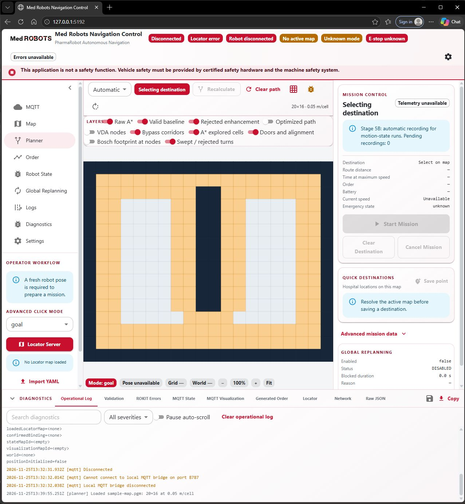

# Mission Planner Phase 1 functional UI fixes

**Worktree** `mission-planner-ui`  
**Branch** `feature/ui-improvements`  
**Audit baseline** `caa7f7af894edd9dacd26600877c68dd4f0cbb9a`

I reviewed [AGENTS.md](AGENTS.md) and the [UI audit](UI_AUDIT_REPORT.md) before editing. Git showed Agent 1’s separate `mission-planner-map` worktree and the separate `master` worktree. All changes are in the UI worktree and await approval to commit or merge.

## Bugs, root causes and fixes

| Audit item | Before and root cause | After | Regression evidence |
| --- | --- | --- | --- |
| F1 — Map controls obscured | The main pane counted the permanent navigation width twice. The fixed mission drawer covered the toolbar and layers, and diagnostics covered the map footer. The canvas measured its parent only when drawing dependencies changed. | Header, workspace and diagnostics use separate grid rows. Navigation and mission have dedicated space, including stacked mission content at narrow widths. Toolbar, layers and zoom controls wrap in normal flow. The canvas tracks viewport size with `ResizeObserver`. Short layouts can scroll their own pane. [Shell](src/App.tsx#L1036), [layout CSS](src/app/styles.css#L24), [canvas sizing](src/components/MapCanvas.tsx#L83). | Edge showed map controls with both panels open. Tests cover mission/diagnostics layout structure, waypoint hit testing, panning, wheel zoom, button limits and Fit. [Workspace and map tests](src/tests/missionPlannerUi.test.tsx#L87). |
| F4 — Stale route and validation status | A local phase string could continue to read “Ready to start” after store invalidation and be overwritten by a previously submitted mission. Order settings and active map changes did not always invalidate route artifacts. Multiple attempts could share a route revision, and a countdown could exit without clearing its display. | The preview status derives from the current route revision and validation. The UI shows calculating, pending, invalid, failed, valid with dispatch blocked, or ready as appropriate. Submitted mission status is separate. Each calculation has its own revision, stale results cannot replace current results, and order settings, active map changes and the maximum node count invalidate preview artifacts. Countdown and confirmation verify current order identity and revision. Dispatch rechecks the existing validator and gates after confirmation against current data. [Route status](src/features/mission/routeStatus.ts#L10), [route invalidation](src/stores/appStore.ts#L85), [planning](src/App.tsx#L367), [dispatch](src/App.tsx#L598), [countdown](src/App.tsx#L677). | Tests exercise ready-to-pending, map/order settings changes, late rejection, invalid vs. failed, stale confirmation and invalidated countdown. Mock assertions verify no publication from these stale paths. [Route tests](src/tests/missionPlannerUi.test.tsx#L251). |
| F5 — Inconsistent replanning authorization | The dedicated panel asked for confirmation and reset its runtime. Settings wrote the same enabled flag directly. Concurrent confirmation attempts could replace the previous dialog. | Both switches call one guarded handler. Enabling requests one confirmation, then updates runtime and reports enablement for eligible missions. A click outside a toast no longer dismisses a replacement notice from that same click. Dismissing leaves it off. Disabling resets the visible runtime and reports the change. Manual Recalculate and Rebuild prepare geometry or a validated preview. The existing dispatch controls authorize execution. [Shared handler](src/App.tsx#L269), [dedicated switch](src/features/replanning/GlobalReplanningPanel.tsx#L44), [recalculate](src/App.tsx#L426). | UI tests repeat the enable request and dismiss it in Settings, then confirm, disable and check both notifications in the dedicated panel. A regression check also covers a switch click while a previous notification is still visible. MQTT publish is mocked and remains unused. [Confirmation test](src/tests/missionPlannerUi.test.tsx#L382). |
| F2 — Escape and stale clear confirmation | The window key listener cleared the goal behind dialogs. A previously opened clear confirmation could also apply to a new route. | Escape in the workspace uses the same Clear Destination flow as its button. Dialogs and editable fields retain their own Escape behavior. A clear confirmation expires when its route revision changes. [Keyboard and clear](src/App.tsx#L733). | Tests preserve the goal when closing Settings, backing out of Clear Destination, and confirming after another revision is selected. [Escape](src/tests/missionPlannerUi.test.tsx#L173), [revision](src/tests/missionPlannerUi.test.tsx#L328). |
| F6 — Offline status and failure feedback | Offline speed showed zero and the motion state showed Idle. Locator startup could stay on “testing” after a failure. Startup checks were based on phase position. Cancel could return or fail silently. The order toast could imply broker acknowledgement before the bridge reported it. | Unavailable or stale telemetry is labelled. Failed Locator startup exits testing and reports the failure. Startup checks reflect connection and map/pose readiness. Cancel is disabled offline, reports a failed publication, and success wording distinguishes MQTT handoff from Navigator acceptance. [Header and mission](src/App.tsx#L1047), [Locator startup](src/features/startup/useStartupConnections.ts#L36), [startup steps](src/features/startup/StartupOverlay.tsx#L12), [instant action](src/App.tsx#L781). | Edge showed Locator error, Robot disconnected and telemetry unavailable. Tests cover offline buttons, mocked Locator failure, actual startup readiness and instant-action publish failure. [Offline](src/tests/missionPlannerUi.test.tsx#L158), [startup](src/tests/startupUi.test.tsx#L21), [action](src/tests/missionPlannerUi.test.tsx#L339). |
| F7 — Misleading action availability | Recalculate had no visible prerequisites. Save point ignored the required map ID. Goal heading was writable without a goal. Recording actions could do nothing with zero pending recordings. The planning start was labelled as the robot pose. | Missing inputs explain why Recalculate is disabled. Save point requires a goal and resolved map ID. Heading, rebuild and recording controls gate on relevant input. The pose panel identifies the planning start. [Prerequisites](src/App.tsx#L889), [map toolbar](src/App.tsx#L1120), [destinations](src/features/destinations/QuickDestinations.tsx#L14), [advanced data](src/App.tsx#L1225). | Offline and navigation tests cover disabled recalculate, saving, cancellation and recording actions, plus the corrected pose label. [UI tests](src/tests/missionPlannerUi.test.tsx#L87). |
| F8 — Settings import could corrupt app state | Import cast arbitrary JSON to a TypeScript shape and spread it into the store. Partial nested settings could erase required fields. Failed imports only logged. | Import accepts recognized settings with runtime-validated values, merges partial settings, strips the imported MQTT password, and supports the bundled legacy example and old maximum-speed field. Invalid files surface the offending field without resetting the robot session. Bosch configuration import also shows success/failure. Imported Bosch width and length use the same locked behavior in both settings sections. [Schema](src/features/settings/settingsFile.ts#L10), [settings actions](src/App.tsx#L1950). | Tests cover round-trip, legacy and partial files, unsupported values, unrelated store keys, retained session and visible errors. [Settings tests](src/tests/settingsFile.test.ts#L12), [import UI](src/tests/missionPlannerUi.test.tsx#L238). |
| F9 — Inert navigation | MQTT, Order, Robot State, Logs and Planner looked actionable and had no navigation behavior. The account icon had no session implementation. | Links open the Network, Generated Order, Robot State/advanced mission and Operational Log views, or focus the planner. The account icon has been removed as a disconnected affordance. [Navigation](src/App.tsx#L1079). | UI test exercises those destinations and planner focus. [Navigation test](src/tests/missionPlannerUi.test.tsx#L87). |
| F10 — Preferences and settings scope | Compact mode, reduced motion, map contrast, auto-clear, and several settings only persisted values. Restore/Export labels implied a broader settings scope than implemented. | Appearance controls apply their settings. Auto-clear clears only the current preview of the completed submitted order when fresh state is available. Preview, radius adjustment and Portuguese are visibly unavailable pending a defined behavior or translation. Restore/Export names identify their planner scope. [Appearance CSS](src/app/styles.css#L58), [auto-clear](src/App.tsx#L773), [settings](src/App.tsx#L1736). | UI tests assert applied preferences, unavailable settings and matching-order auto-clear behavior. [Appearance](src/tests/missionPlannerUi.test.tsx#L223), [auto-clear](src/tests/missionPlannerUi.test.tsx#L369). |
| F11 — Diagnostics filters and file feedback | Filters and Clear view were displayed on unrelated tabs. The pause switch did nothing, clipboard rejection was ignored and YAML staged silently. | Log controls operate only on Operational Log. Auto-follow can pause and resume, and copy reports success or failure. Local imports report activity and result. Staged YAML names its source, can be cleared and is consumed by a successful image import. [Diagnostics](src/App.tsx#L1460), [imports](src/App.tsx#L807). | Tests cover log auto-follow/pause, tab scope, copy failure, staged metadata and a malformed map file. Edge loaded the bundled PGM with an import result. [Diagnostics and imports](src/tests/missionPlannerUi.test.tsx#L187). |
| F12/F14 — Map interaction and presentation | Wheel and buttons had different zoom limits. Right-click could leave mismatched world/grid values. The VDA nodes layer drew final-path points. The duration and corridor text overstated their inputs. | Zoom controls share bounds. Pointer information stays consistent or clears. The VDA node layer uses the generated order. Timing reads “Time at maximum speed” and the corridor warning identifies the local planner setting. [Canvas](src/components/MapCanvas.tsx#L22), [node drawing](src/components/MapCanvas.tsx#L216), [mission details](src/App.tsx#L1163). | Tests cover inspection, zoom and VDA markers with a generated order distinct from the preview path. [Canvas tests](src/tests/missionPlannerUi.test.tsx#L109). |

## Replanning policy and execution boundaries

- **Recalculate**, map destination selection and **Rebuild Order From Current Pose** prepare the current route. Manual Recalculate and Rebuild do not publish orders. When Direct Dispatch is already enabled, the existing destination workflow may start its cancellable countdown after successful order validation.
- **Start Mission** and **Corridor Compatibility Test** are separate confirmed publication actions. A route revision change while a confirmation is open invalidates the earlier approval. The dedicated compatibility session can still compare variants using its saved base route.
- **Enable automatic replanning** authorizes the existing automatic replacement workflow for eligible blocked missions. The previous dedicated dialog and runtime already defined this arming policy, including the absence of a per-replacement prompt. The existing setting persists across restarts. Automatic blocked-robot recovery is a separate setting used by the same runtime. Its permissions and safeguards were left as implemented. The runtime checks the enabled flag before starting a cycle. An in-progress transition has its own lifecycle. Explicit approval is needed before changing whether restart, recovery or an in-progress transition requires further confirmation or cancellation.
- Locator clearance diagnostics run on a separate diagnostic request. They have no mission dispatch action. The planners, route collision checks, recovery algorithms and robot safety gates were kept as-is. Phase 1 changes how the existing gates are reported and when current inputs are refreshed for UI-triggered dispatch.

## Validation

The UI tests use synthetic telemetry and mocks for MQTT publication, startup networking and automatic replanning. The browser used only the frontend server at `127.0.0.1:5192`; the bridge on port 8787 stayed stopped. No commands were sent to the physical robot.

| Check | Result |
| --- | --- |
| TypeScript type checking | Passed |
| ESLint | Passed |
| Full sequential suite, `npm test -- --maxWorkers=1` | **448/448 passed**, 53 files, 59.26 s. All 420 baseline tests and all 28 new tests passed. |
| Full parallel suite, `npm test` | **447/448 passed**, 52 of 53 files passed, 27.91 s. All 28 new tests passed. The global replanning timing assertion below was the only failure. |

The audit baseline was **420/420 passing sequentially**. These historical parallel failures are tracked separately from UI regressions.

| Previously failing parallel planner test | Audit result | Phase 1 parallel result |
| --- | --- | --- |
| Global replanning routes around a temporary obstacle | 408.6 ms exceeded the 200 ms assertion. [Assertion](src/tests/globalReplanning.test.ts#L301). | Failed again at 280.4 ms. An isolated one-worker rerun passed all 24 tests in this file. |
| Hierarchical planner widens a point-guide corridor | Route returned `success=false` in the parallel run. [Assertion](src/tests/motionStateHierarchicalPlanner.test.ts#L89). | Passed. |
| SendBox-scale clutter with production costs | 3186.5 ms exceeded the 2500 ms assertion. [Assertion](src/tests/motionStateSendBoxPerformance.test.ts#L111). | Passed. |

All three historical failures passed when rerun with one worker during the audit.

### Browser evidence

Edge reached degraded startup with the expected failed/missing service states. I selected **Continue in advanced mode**, imported the bundled `sample-map.pgm` locally, and saw the loaded **20 × 16 grid at 0.05 m/cell** and the import confirmation. With diagnostics expanded, the mission panel sat beside the map, and the toolbar, layer controls and zoom row were all visible. Computer Use was stopped after the screenshot. The narrow-width layout, map gestures and confirmation dialogs have automated coverage as described above, with desktop rendering verified in Edge.

[Audit screenshot before the layout fix](artifacts/ui-audit/02-offline-workspace.jpg) · [Full-size Phase 1 screenshot](artifacts/ui-phase-1/01-desktop-diagnostics.jpg)

## Shared files and remaining limitations

| Shared edge | Phase 1 changes and merge considerations |
| --- | --- |
| [App grid loader and map controls](src/App.tsx#L344) | Local import has feedback and completion guards. The existing canvas click dispatch and occupancy transformation remain the editor integration seam. When integrating Agent 1’s work, preserve the grid layout and place any edit tool controls inside the map column. |
| [MapCanvas](src/components/MapCanvas.tsx#L70) | The edit and display surfaces share the canvas. Phase 1 changed sizing, control placement, zoom bounds, pointer feedback and VDA node display. Canvas props, grid-to-world conversion and the callback for map clicks retain their contract. If Agent 1 changes input handlers or drawing overlays, reconcile within the measured viewport and keep the control rows outside the canvas element. |
| [Main store](src/stores/appStore.ts#L85) | Route input invalidation now also covers order settings and resolved map ID. A future editable planning map must preserve the revision guards so edits invalidate the correct preview. Keep the active sent mission separate from any draft map or route. |
| [Other UI files](src/features/replanning/GlobalReplanningPanel.tsx#L10) | The dedicated replanning dialog accepts the shared confirmation-pending state. Startup overlay/hook report readiness. Quick Destinations gates Save on map identity. The new route-status and settings-file modules serve the renderer and tests. |

- The Map Cleaner draft, edit overlays, undo and original-versus-edited raster behavior (F3) belong to the parallel Map Cleaner work. Keyboard/touch map placement requires agreement on the shared gesture model. Existing mouse behavior is covered.
- Bridge endpoint configuration across remote hosts, HTTPS and nondefault ports (F13) and actual broker acknowledgement semantics need service integration verification. The UI now reports the handoff accurately. VDA Pause, Resume and State request remain visible and disabled under the existing ROKIT compatibility constraints.
- Portuguese localization, route-radius semantics and a different dispatch-preview policy require product or operational decisions. Other numerical fields retain their existing live-edit behavior. Settings file validation is separate from those inputs.
- Real Navigator, Locator and ctrlX services, live mission/replacement/recovery execution, physical telemetry and packaged Electron remain unverified. Browser verification used a local fixture and a stopped robot bridge.
