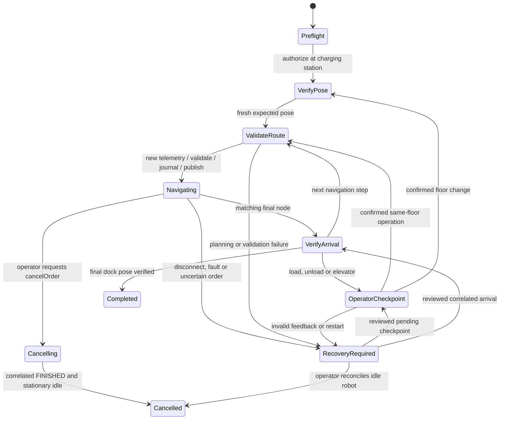

# Sprint 4 — Pharmacy → Urgencies → Charging Station

Sprint 3 is checkpointed in local commit `89f62c0`. Sprint 4 is uncommitted on `feature/ui-improvements` in `mission-planner-ui`. All execution evidence below comes from fixtures. No physical robot or elevator commands were sent.

## Mission contract

One initial authorization covers nine same-floor orders. Six separate operator confirmations release operational checkpoints. A positive answer alone cannot release a route. The backend also requires current robot evidence, the expected map and a validated order.

| Stage | Robot movement, evidence and required operator action |
| --- | --- |
| A · Collection | Verify the idle robot at `Charging station`. Navigate to `Pharmacy_w8_4_medicine`, verify arrival and ask **Has the medicine been placed inside the robot?** |
| B · Pharmacy elevator | Navigate to `Pharmacy_w8_4_elevator`. Ask **Is the elevator open and safe to enter?** Validate and send the route to `Pharmacy_inside_elevator`. Verify stationary arrival. |
| C · Urgencies transition | Ask **Has the elevator reached the urgencies floor?** The operator uses the commissioned floor-switch and relocalisation procedure. Verify the pose at `Urgencies_inside_elevator` on the urgencies map, then route to `Urgencies_w8_4_elevator`. |
| D · Delivery | Navigate to `Urgencies_deliver_medicine`, verify arrival and ask **Has the medicine been removed from the robot?** |
| E · Return to elevator | Navigate back to `Urgencies_w8_4_elevator`, ask **Is the elevator open and safe to enter?**, then navigate to `Urgencies_inside_elevator` and verify stationary arrival. |
| F · Pharmacy transition | Ask **Has the elevator reached the pharmacy floor?** Verify fresh localisation at `Pharmacy_inside_elevator` on the pharmacy map, then navigate to `Pharmacy_w8_4_elevator`. |
| G · Return | Navigate to `Charging station`, verify the final node, pose and stationary state, then record completion. The summary claims charging only when the actual arrival state contains `batteryState.charging === true`. |

## Architecture

- **Template and engine.** The ordered template declares navigation, confirmation, map transition, localisation verification and completion steps. The engine owns the run ID, step index, revision, last verified waypoint, order intent, cancel action ID and timestamped event history. Separate ports supply the clock, durable save, planner, validator and transport. The UI renders the backend state. [Template](src/features/pharmacy/model.ts) · [Engine](server/deliveryEngine.ts)
- **Backend lifetime.** The bridge opens its own clean MQTT session on preparation. A browser refresh or closure leaves the mission running on the backend. The session subscribes to Navigator state and connection and filters robot identity. Automatic MQTT reconnection is disabled for this session. A backend restart restores an unfinished run in recovery and sends no order. Closing packaged Electron can stop its bridge process and therefore requires recovery on restart. [Bridge service](server/deliveryService.ts) · [Electron](electron/main.ts)
- **Durability and ownership.** Configuration, registered maps and run history live in `MISSION_DATA_DIR`, defaulting to `data/pharmacy-delivery` for the standalone bridge and the application user-data directory in Electron. The journal is synchronously written and flushed to a temporary file and renamed before publication. Previous runs remain available in history. An OS owner endpoint keyed by directory prevents two instances using the same journal. Keep one authoritative bridge and journal per robot. The MQTT password is session-only. [Server startup](server/index.ts)
- **Dispatch.** Each leg runs the selected planner or manual geometry checks, with the existing footprint, grid inflation, VDA builder, live validator, node limit and dispatch gates. After planning, a newer state sample must pass departure and live-order checks before the intent is persisted and published. No cross-floor edge is generated. Ordinary Mission Planner order publishers request backend permission so they cannot compete with an active delivery. Quick missions and structured per-leg missions keep their existing authorization flows. The updated bridge must be reachable for order arbitration, including direct WebSocket MQTT mode. Independent external broker clients require site-level command ownership controls. [Planning adapter](server/deliveryPlanning.ts) · [Renderer MQTT service](src/services/MqttService.ts)

## Configuration and operator interface

1. Create the seven exact names in Waypoints. Each must have a distinct saved ID, finite world coordinates and an explicit heading. Use one map for the four pharmacy points and a distinct map for the three urgencies points. Preflight rejects ambiguous names and occupied, out-of-bounds or footprint-invalid configurations.
2. Load each floor through Locator. In **Missions → Library → Pharmacy → Urgencies → Charging Station**, register its loaded raster. The registration uses the existing raster-to-occupancy conversion. Registration is explicit for each floor and the active mission freezes its maps. Re-register both maps following site-map changes.
3. Prepare the mission to bind the saved waypoint IDs, map snapshots, vehicle geometry, planner settings, robot identity and topics. Start at the charging station after live readiness succeeds. Confirm the complete mission once. At checkpoints, **Not yet** or dismissal leaves the step pending. Reopen it in the execution panel. The run ID and revision accompany each response and appear in the persisted event sequence.
4. During elevator travel, operate the elevator and switch/localise the robot using the site procedure. A manually selected application raster or last-known map cannot establish which floor the robot occupies. The engine requires the map ID carried by the actual Navigator state pose. A state received on the new floor before operator confirmation cannot trigger exit.

The execution panel provides stage, current and next waypoint, timeline, completed/remaining steps, elapsed time, map, connection, localisation, pending confirmation, faults and prior runs. Checkpoints can reappear after a browser refresh without opening the library. [Console](src/features/pharmacy/DeliveryConsole.tsx) · [API client](src/features/pharmacy/deliveryApi.ts) · [Library entry](src/features/mission/MissionsPanel.tsx) · [Workspace](src/App.tsx) · [Timeline styling](src/app/styles.css)

**Browser evidence.** These are real Edge renders of intercepted fixture state, with service traffic and robot WebSockets blocked. [Mission setup](artifacts/ui-phase-4/01-setup.jpg) · [Mandatory elevator confirmation](artifacts/ui-phase-4/02-checkpoint.jpg) · [Timeline after Not yet](artifacts/ui-phase-4/03-timeline.jpg)

## Localisation, faults and recovery

- The supported base criteria are a fresh, finite, initialized state pose with matching map, position and orientation within configured VDA tolerances. Both payload timestamp and local receipt age are checked. Retained state cannot establish readiness. Stationary checks require `driving === false`, no active movement and zero supplied velocity components. The bridge and robot need synchronized clocks.
- The repository has no commissioned Locator score cutoff. If the state supplies `agvPosition.localizationScore`, configure the site-approved `DELIVERY_MIN_LOCALIZATION_SCORE` in the range 0–1. When configured, a missing or insufficient score blocks progression. Without a reported score or configured cutoff, only the supported initialized-pose and consistency criteria are applied.
- Arrival requires a post-dispatch state for the exact order ID and update, final node ID and sequence, empty pending nodes and edges, the expected floor and waypoint pose, and stationary feedback. Missing acceptance, invalid pose, emergency stop, field violation, robot error, lost communications or failed validation suspends progression. Suspension cannot establish a physical stop.
- A live, correlated active order can be cancelled through the existing supported `cancelOrder`. The panel waits for its matching finished action and stationary idle evidence. After uncertainty, reconnect telemetry and explicitly authorize review. An outstanding navigation intent is never replayed. Recovery can accept a proven arrival, restore an unconfirmed checkpoint, or let an operator reconcile and end the run after idle feedback. If safety readiness is unavailable, use the site's robot intervention procedure.
- Confirmations are not elevator interlocks. No Schindler control, door sensing, electronic compartment lock, automatic map-switch or relocalisation command is implemented. The current ctrlX integration reads configured signals and does not provide a commissioned floor-switch command. Future integrations can supply evidence or add step adapters without changing the core navigation algorithms.

## Verification

| Check | Result |
| --- | --- |
| TypeScript and ESLint | `npm run typecheck` and `npm run lint` passed. |
| Server build | `npm run server:build` passed. A separate idle startup check exercised the compiled bridge with a disposable journal and no robot connection. |
| Complete sequential suite | **490/490 passed** in 57 files, in 81.27 s. The Sprint 3 baseline was 466 tests. Sprint 4 adds 24. |
| Complete parallel suite | **489/490 passed** in 40.64 s. All 24 delivery regressions passed. Global replanning took 249.9 ms against a 200 ms limit. |
| Isolated planner rerun | **35/35 passed** across global replanning and SendBox with one worker. |
| Browser evidence | Three 1920×1080 screenshots show the library setup, elevator confirmation and timeline after deferral using intercepted data. |

**Previously documented parallel failures.** Of the original three, the global-replanning timing assertion recurred. The hierarchical point-guide corridor case and the SendBox clutter timing assertion both passed in this parallel run. The separate SendBox guide budget failure reported in Sprint 3 also passed. Planner algorithms and timing thresholds are unchanged. [Original audit](UI_AUDIT_REPORT.md) · [Sprint 3 results](UI_PHASE_3_REPORT.md)

Fixture coverage includes the outbound and return sequence, all six confirmations, automatic same-floor progression, a real planner/builder/validator leg, bad waypoint bindings, incorrect floor, stale and invalid localisation, score failure, both transition gate orderings, disconnection, restart, duplicate requests, stale arrival, cancellation acknowledgement, route failure and safety faults. The bridge integration test intercepts MQTT, exercises HTTP handlers, writes a real temporary journal and recreates the service. The React test dismisses and remounts a pending confirmation. [Engine regressions](server/deliveryEngine.test.ts) · [Bridge integration](server/deliveryService.test.ts) · [Popup regression](src/tests/deliveryConsole.test.tsx)

## Integration and live validation

| Changed area | Files |
| --- | --- |
| Mission template, contracts and operator interface | [model.ts](src/features/pharmacy/model.ts), [DeliveryConsole.tsx](src/features/pharmacy/DeliveryConsole.tsx), [deliveryApi.ts](src/features/pharmacy/deliveryApi.ts), [MissionsPanel.tsx](src/features/mission/MissionsPanel.tsx), [App.tsx](src/App.tsx), [styles.css](src/app/styles.css) |
| Execution, route checks and bridge ownership | [deliveryEngine.ts](server/deliveryEngine.ts), [deliveryPlanning.ts](server/deliveryPlanning.ts), [deliveryService.ts](server/deliveryService.ts), [index.ts](server/index.ts), [MqttService.ts](src/services/MqttService.ts) |
| Packaging and persistence | [Electron main process](electron/main.ts), [server/tsconfig.json](server/tsconfig.json), [package.json](package.json), [package-lock.json](package-lock.json) |
| Regression coverage | [deliveryEngine.test.ts](server/deliveryEngine.test.ts), [deliveryService.test.ts](server/deliveryService.test.ts), [deliveryConsole.test.tsx](src/tests/deliveryConsole.test.tsx), [missionPlannerUi.test.tsx](src/tests/missionPlannerUi.test.tsx), [vdaReverseExecution.test.ts](src/tests/vdaReverseExecution.test.ts) |

Waypoint management still uses browser-local storage. Preparation and recovery compare the seven saved bindings with the backend snapshot. The operator UI reports edits during a run and retries failed reports while open. The backend cannot observe an edit made in a disconnected client until that client communicates it. Registered grids and the authorized waypoint snapshot remain the source for the active run.

Agent 1's worktree and map processing code were untouched. Registered maps currently originate from Locator rasters. Integrating Map Cleaner will require an explicit choice of authorized map revision and invalidation of frozen snapshots when appropriate. The server build bundles the existing TypeScript domain implementations for Node. [Server build](package.json) · [Server TypeScript settings](server/tsconfig.json)

Live ctrlX CORE, Navigator and elevator validation is pending. Commission both floor frames, all headings and tolerances, actual localisation-quality reporting, synchronized timestamps and state cadence, load/unload supervision, door clearance, stop feedback, cancellation and recovery on the actual installation. Verify the production broker ACLs, journal persistence, transport security and exclusive command station. The local application-origin boundary does not provide individual operator identity or role-based authentication.

